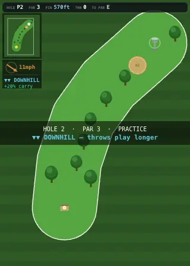

# Disc Golf Arcade

A retro pixel-art disc golf game for phone and desktop. Pull back to aim, pick a disc and a release angle, read the wind and the slope, and try to beat today's Daily.

**Play it:** https://discgolfarcade.com



## What's in it

- **Daily Challenge:** a fresh 9-hole course every day (same for everyone), three star goals tuned to how hard it plays, its own leaderboard, and a Daily streak.
- **Courses and Pro Tour:** fixed championship courses (Glendoveer East, Winthrop Lake, Olympus) plus seeded tour venues, each with a leaderboard.
- **Career:** a sandbox pro career from age 20: four skills (power, control, putting, mental) trained between seasons, amateur to pro schedules, sponsors, rivals, world rank, a separate disc bag and cosmetics.
- **Ranked:** monthly seasons with placement rounds, tiers and an all-time board.
- **Tournaments:** multi-round events against a simulated field, with cuts and live standings.
- **Online:** private lobbies over Supabase Realtime with live ghosts of the other players' throws; challenge links that replay your exact round; shareable round replays.
- **Practice:** Putting and Accuracy minigames (each with a board), any hole on any course, and an animated How to Play.
- **Progress:** levels with disc drafts, 20 achievements, a Next-goal card, coins, and a shop of disc skins, trails, baskets, aim lines, course themes and celebrations.
- **Feel:** a flight model with turn, fade, glide, wind and elevation; sound, haptics, screen shake and particles; a phone layout that fills the screen and a three-column desktop layout with keyboard shortcuts.
- **Accounts are optional:** guests play everything. Signing in syncs progress across devices and keeps your leaderboard name yours.

## How it's built

Next.js 16 (App Router), React 19, TypeScript, Tailwind 4, Supabase, Vercel.

| Part | Where | What it does |
|---|---|---|
| Game logic | `lib/discgolf/*` | Pure, deterministic TypeScript: course generation from a seed, flight physics, scoring, career, ranked, tournaments, wallet, goals. No React, no I/O, unit-tested. |
| The game | `components/disc-golf-game.tsx` | One client component that owns the round state and draws everything to a 320×448 canvas, upscaled with `image-rendering: pixelated`. |
| Screens | `components/panels/`, `components/menu/`, `components/play/` | Menu, panels (career, shop, ranked, …), the in-round controls and the desktop side columns. |
| Helpers | `components/game/` | Canvas drawing, course info, storage keys, online/ghost helpers. |
| Save + sync | `lib/progress.ts` | Progress lives in `localStorage`; signed-in players mirror it to the `arcade_progress` table (row-level security, own row only) with a loss-free merge. |
| Leaderboards | `actions/arcade.ts`, `lib/leaderboard/` | Server actions with the service-role key write through a `SECURITY DEFINER` RPC that keeps each player's best. Signed-in rows are keyed by user id; guests post under a chosen name or skip. |
| Online | Supabase Realtime channels | Lobbies, per-hole scores and ghost throws. |

## Run it locally

```bash
npm install
npm test            # vitest: 400 tests
npx tsc --noEmit
npm run lint
```

**Keep test rounds off the live leaderboard.** `.env.local` holds the real Supabase project, and environment variables set in the shell override it. Point Supabase at a dead address when you play locally:

```bash
NEXT_PUBLIC_SUPABASE_URL=http://127.0.0.1:9 \
NEXT_PUBLIC_SUPABASE_ANON_KEY=dead \
SUPABASE_SERVICE_ROLE_KEY=dead \
npm run dev
```

Everything works offline except sign-in, leaderboards and online lobbies (board requests fail after a few seconds).

`npm run dev` runs `scripts/dev-cache-guard.mjs` first. It clears Turbopack's dev cache (`.next/dev`) if the project has moved folders since the cache was built, which used to crash dev with "Next.js package not found".

### The README clip

`scripts/capture-hole.mjs` records `docs/hole.webp` from a local dev server: a bot plays a practice hole using the dev-only `window.__dga` probe, and `img2webp` (`brew install webp`) stitches the frames. The comment at the top of the script has the command.

## Database

SQL lives in `supabase/`. Apply new migrations in the Supabase SQL editor, then deploy.

- `arcade_scores.sql`, `arcade_progress.sql`: the original tables and RPC.
- `2026-10-15_arcade_scores_user_id.sql`: signed-in leaderboard rows keyed by user id, and guest names that can't take a signed-in player's name. The code falls back to the old behaviour until it's applied, and the migration keeps the currently deployed site working, so it's safe to apply before deploying.

## Notes

- Disc molds and course/event names are real (Innova, Discraft, Latitude 64, …). That's fine for a free fan game; they'd need generic names before charging for anything.
